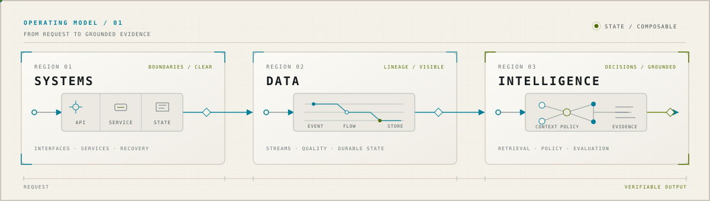

  

  

  
  
  
  

<picture>
  <source media="(prefers-reduced-motion: reduce) and (prefers-color-scheme: dark)" srcset="./assets/readme/systems-static-dark.svg">
  <source media="(prefers-reduced-motion: reduce)" srcset="./assets/readme/systems-static-light.svg">
  <source media="(prefers-color-scheme: dark)" srcset="./assets/readme/systems-dark.svg">
  
</picture>

I build the layer around the model — typed interfaces, replayable evidence, evaluation gates before anything gets to decide.

<!--
---

### 🛠️ Building

**[TracePilot](https://github.com/aayushtiwari845/TracePilot)** — correlates metrics, logs, traces, and topology into evidence-cited root-cause rankings for distributed systems, with a deterministic baseline the learned ranker has to beat before it's allowed to run.
`Python` `FastAPI` `PostgreSQL/pgvector` `MLflow` `Kubernetes` `OpenTelemetry`

**[CONCLAVE](https://github.com/aayushtiwari845/Consensus-AI)** — four LLM agents negotiate mutual-fund picks through NSGA-II ranking and Kemeny-Young consensus, backtested end-to-end on real market data. Research prototype, not a fund recommender.
`Python` `Ollama · Qwen2.5` `NumPy` `SciPy` `Streamlit` · [case study](https://aayushktiwari.tech/projects/conclave)

**[CivicLens](https://github.com/aayushtiwari845/Civic-Issues-Dashboard)** — civic-issue reporting platform with GPS/media capture, offline queues with background sync, PostGIS-based routing, and SLA tracking.
`FastAPI` `React` `PostgreSQL/PostGIS` `Redis` `OAuth2/JWT`

More on <a href="https://github.com/aayushtiwari845?tab=repositories">github.com/aayushtiwari845</a> and <a href="https://aayushktiwari.tech">aayushktiwari.tech</a>

---

### 💼 Experience

**Barclays**, Technology Developer Intern · 2026 — configuration-driven sanctions-screening platform processing 80M+ record files, with RBAC, audit logging, and full Pytest coverage.

**Makeflow India**, Backend Developer Intern · 2025 — refactored an AI-counselling backend into modular services: −40% inter-service coupling, sub-100ms crisis routing.

**Segmentriq Analytics**, Data Analytics Intern · 2024–25 — ETL pipelines across 5+ sources into Power BI dashboards, −35% ad-hoc reporting turnaround.

---

### 📊 GitHub Stats

  
  

-->

---

### My Tech Stack

  

  

  

---

> [!NOTE]
> **Recruiting or reviewing this profile?** → [Résumé](https://aayushktiwari.tech/resume) · [Portfolio](https://aayushktiwari.tech) · [Email](mailto:aayushkumar345@gmail.com)

  

